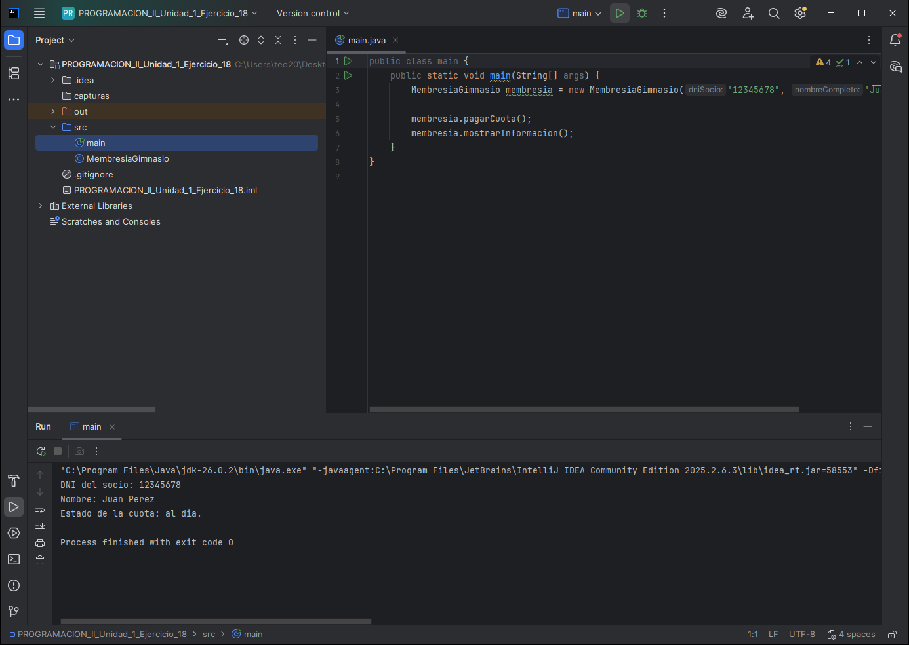

# PROGRAMACIÓN II — Unidad 1, Ejercicio 18: Registro de Inscripción a Gimnasio

Trabajo práctico de Programación II. Este repositorio contiene la resolución en Java del ejercicio 18 de la Unidad 1.

## Consigna

#### Contexto

Los centros de acondicionamiento físico gestionan las membresías de sus socios, controlando el tipo de plan contratado y si el pago mensual se encuentra al día.

#### Consigna

Crear una clase en Java que modele la membresía de un socio en un gimnasio y permita gestionar el estado de su cuota.

#### Desarrollo requerido

- Definir la clase MembresiaGimnasio con los atributos privados dniSocio (String), nombreCompleto (String) y cuotaAlDia (boolean).
- Incorporar un constructor que inicialice los datos del socio y establezca por defecto cuotaAlDia en falso.
- Implementar los métodos pagarCuota() (que cambie el estado a verdadero) y registrarVencimiento() (que vuelva el estado a falso), junto a un método para mostrar la información.
- En el método main, instanciar una membresía, simular el pago de la cuota y mostrar el estado actualizado del socio por consola.

## Estructura del repositorio

```
PROGRAMACION_II_Unidad_1_Ejercicio_18/
├── README.md
├── capturas/
│   └── consola.png
└── src/
    ├── main.java   # clase con el método main
    └── MembresiaGimnasio.java
```

## Funcionamiento y lógica

### `MembresiaGimnasio`

Modela la membresía de un socio con los atributos privados `dniSocio`, `nombreCompleto` y `cuotaAlDia` (boolean).

- **Constructor:** guarda DNI y nombre, y toda membresía nueva empieza con la cuota pendiente (`cuotaAlDia = false`).
- **`pagarCuota()`:** marca la cuota como al día.
- **`registrarVencimiento()`:** vuelve a marcar la cuota como pendiente.
- **`mostrarInformacion()`:** imprime DNI, nombre y el estado de la cuota, que se decide con un `if / else` sobre `cuotaAlDia`.

### `main`

Crea la membresía de Juan Perez (DNI 12345678), registra el pago de la cuota y muestra la información: la cuota figura **al día**.

## Ejecución

Captura de la consola de IntelliJ IDEA ejecutando el programa:



Salida obtenida:

```
DNI del socio: 12345678
Nombre: Juan Perez
Estado de la cuota: al dia.
```
